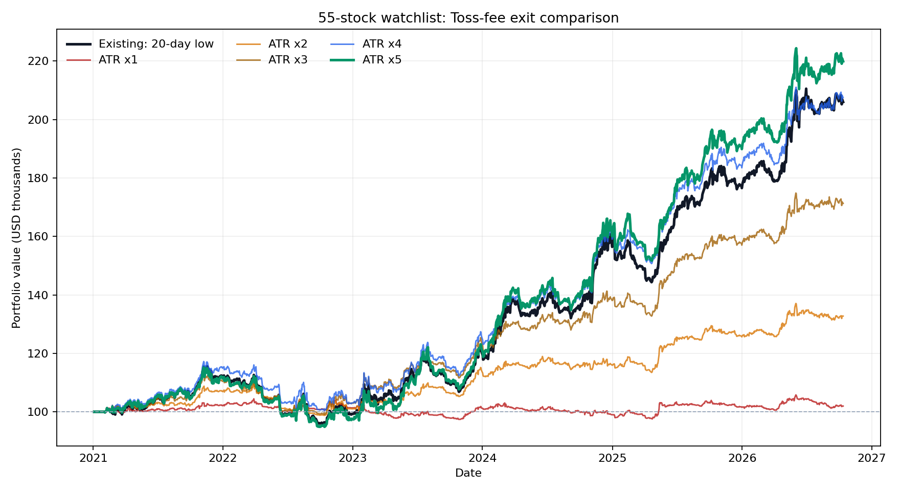

# 기본 감시 목록 55종목: 토스증권 미국 주식 수수료 반영

기간: 2021-01-04 ~ 2026-10-12. 시작 자금: USD 100,000. 원래의 20일 저점 청산과 22일 샹들리에 엑시트(ATR 1~5배)를 같은 진입·손절 규칙으로 비교했다.

## 결과

| 청산 방식 | 총수익률 | 연환산 | 최대 낙폭 | 청산 거래 | 매매수수료 합계 | SEC 비용 합계 |
|---|---:|---:|---:|---:|---:|---:|
| 기존 20일 저점 | +105.99% | +13.35% | -17.03% | 1,310 | $5,971.69 | $7.77 |
| 샹들리에 ATR × 1 | +1.97% | +0.34% | -6.73% | 4,798 | $16,567.41 | $17.12 |
| 샹들리에 ATR × 2 | +32.75% | +5.03% | -10.00% | 2,710 | $10,654.15 | $12.79 |
| 샹들리에 ATR × 3 | +71.30% | +9.78% | -13.18% | 1,793 | $7,922.73 | $10.38 |
| 샹들리에 ATR × 4 | +107.47% | +13.49% | -14.28% | 1,374 | $6,504.67 | $8.36 |
| 샹들리에 ATR × 5 | +119.89% | +14.64% | -17.62% | 1,153 | $5,350.09 | $7.46 |

수수료 합계는 매수와 매도에 실제로 차감했다고 **모형이 가정한 금액의 합계**다. 마지막 날 미청산 포지션은 종가로 평가하고 미래 매도 수수료는 미리 차감하지 않았다.

## 적용한 토스증권 비용

- [토스증권 Open API 공식 안내](https://home.tossinvest.com/ko/open-api): 미국 주식 매수·매도 각각 거래금액의 0.1%; 주문건당 체결금액 $10 이하 수수료 면제.
- [토스증권 공식 수수료표](https://p.tossinvest.com/en/business?tab=commission): 매매수수료 $0.01 미만 절사; 2026-04-02 이후 매도에 `max($0.01, 매도금액 × 0.00206%)`의 SEC 비용을 센트로 반올림하여 적용.
- **현재 기본 수수료율**을 2021년 이후의 모든 가상 거래에 적용했다. 과거 계좌별 이벤트·협의 요율은 복원하지 않았다. 시작 자금은 이미 USD로 보유했다고 가정하므로 환전 비용은 제외했다. 주문 호가 차이, 실제 지정가 미체결, 양도소득세도 제외했다.

직전의 0.1% 일률 비용 모형과 **같은 가격 데이터**로 나란히 계산하면 총수익률 차이는 -0.01~+0.03%포인트다. 앞선 결과 파일과 숫자가 조금 다른 부분은 가격 데이터 재조회 및 센트 절사·주문 수량 경로의 차이 때문이다. 동일 데이터에서의 정확한 비교는 `cost_comparison.csv`에 있다. 수수료를 두 번 더하지 않았다.

## 전략과 해석상 제한

- 진입: 당일 고가가 직전 20거래일 최고가 돌파. 모든 경우 고정 손절은 `진입 신호일 종가 − 2 × 직전 ATR(14)`로 동일하고 이후 종가로 판정.
- 기존 청산: 당일 저가가 직전 20거래일 최저가 이탈. 샹들리에 청산: 당일 저가가 `직전 22거래일 최고가 − 배수 × 직전 ATR(22)` 이탈. 보유 중 샹들리에 기준선은 낮추지 않음. ATR은 TR의 단순 이동평균.
- 확정 일봉에서 신호를 만들고 다음 거래일 시가에 정수 주식으로 체결했다고 가정. 같은 날 여러 진입 신호는 ADX가 높은 순. 신규 진입 예산은 남은 현금 ÷ (55 − 보유 감시 종목 수).
- 현재의 55종목을 과거 전체 기간에 적용했다. 과거에 없어졌거나 현재 목록에 없는 종목을 포함하지 않으므로 생존자·사후 선정 편향이 있다. 배율 1~5 중 최고값을 같은 기간에서 고르는 과최적화 위험도 있다.

재실행: `python backtest_exits.py --start 2021-01-01 --end 2026-10-13 --cash 100000 --toss-fees --output backtest_results_55_toss`

세부 데이터는 `summary.csv`, `trades.csv`, `cost_comparison.csv`, 평가액 CSV 및 `assumptions.json`에 있다.
