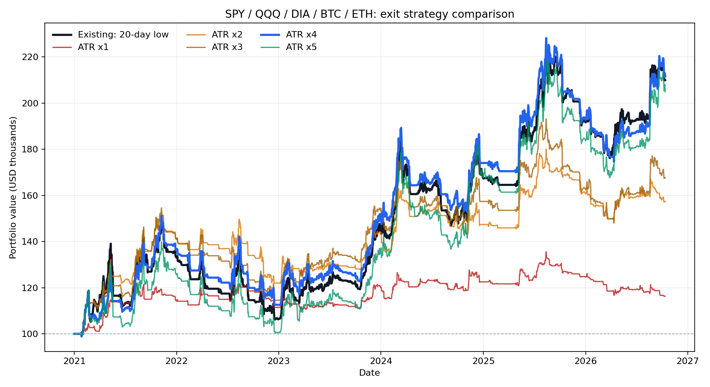

# QQQ·SPY·다우(DIA)·비트코인·이더리움 청산 방식 비교

기간: 2021-01-01 ~ 2026-10-12. 다우는 [DIA ETF](https://www.ssga.com/us/en/individual/etfs/state-street-spdr-dow-jones-industrial-average-etf-trust-dia), 가상자산은 BTC-USD와 ETH-USD 현물 가격을 사용했다.

## 5개 자산 묶음

시작 자금 $100,000을 5개 자산의 빈 슬롯에 따라 배분하는 모의 포트폴리오다.

| 청산 방식 | 총수익률 | 연환산 | 최대 낙폭 | 청산 거래 |
|---|---:|---:|---:|---:|
| 기존 20일 저점 | +109.91% | +13.70% | -28.75% | 138 |
| 샹들리에 ATR × 1 | +16.32% | +2.65% | -14.21% | 498 |
| 샹들리에 ATR × 2 | +57.40% | +8.17% | -19.75% | 287 |
| 샹들리에 ATR × 3 | +67.48% | +9.34% | -25.95% | 190 |
| 샹들리에 ATR × 4 | +111.51% | +13.85% | -25.62% | 146 |
| 샹들리에 ATR × 5 | +104.90% | +13.22% | -28.20% | 120 |

## 자산별 단독 운용: 총수익률

각 행은 해당 자산 하나에 $100,000을 배정하여 별도로 계산했다. 오른쪽의 단순 보유는 신호 전략과 다른 참고값이며 거래 비용을 빼지 않았다.

| 자산 | 기존 | ATR × 1 | ATR × 2 | ATR × 3 | ATR × 4 | ATR × 5 | 단순 보유 |
|---|---:|---:|---:|---:|---:|---:|---:|
| QQQ | +57.07% | +24.76% | +2.44% | +43.86% | +47.89% | +55.00% | +149.39% |
| SPY | +73.51% | -1.18% | +5.31% | +60.99% | +62.27% | +61.55% | +127.79% |
| DIA | +26.53% | -8.33% | +15.84% | +31.95% | +43.42% | +31.44% | +89.19% |
| BTC-USD | +69.67% | +5.86% | +82.24% | -9.81% | +48.34% | +7.16% | +178.35% |
| ETH-USD | +332.25% | +51.75% | +191.11% | +192.15% | +371.21% | +527.15% | +234.67% |

## 공통 규칙과 제한

- 진입: 당일 고가가 직전 20거래일 최고가를 돌파. 손절은 **진입 신호일 종가 − 2 × 직전 ATR(14)**로 고정하며 이후 종가로 판정한다.
- 기존 청산: 당일 저가가 직전 20거래일 최저가 아래. 샹들리에 청산: 당일 저가가 `직전 22일 최고가 − 배수 × 직전 ATR(22)` 아래. 보유 중 샹들리에 기준선은 낮추지 않는다. ATR은 TR의 단순 이동평균이다.
- 확정 일봉에서 신호를 만들고 다음 일봉 시가에 체결한다고 가정한다. 각 방향에 가격의 0.1%를 가상 거래 비용으로 반영한다.
- 묶음의 신규 배정액은 남은 현금 ÷ (5 − 보유 자산 수). ETF는 정수 주식, 가상자산은 소수점 8자리까지 구매한다. 여러 진입 신호가 겹치면 ADX가 높은 순으로 처리한다.
- ETF는 미국 주식 거래일, 가상자산은 매일 거래한다. 특히 혼합 포트폴리오는 서로 다른 장의 개장 시점을 날짜 단위로 단순화했다. 토스증권 미국 주식 주문 체결을 그대로 재현한 값이 아니다.
- 데이터는 Yahoo Finance 조정 일봉이다. 실제 세금·환전·호가 차이·주문 미체결은 반영되지 않았다. 배율 1~5의 우열은 이 표본 기간에 한정되며, 최고 성과 배율을 같은 기간에서 고르면 과최적화 위험이 있다.

재실행: `python backtest_cross_asset.py --start 2021-01-01 --end 2026-10-13`

상세 수치는 `basket_summary.csv`, `per_asset_summary.csv`, `basket_trades.csv`, `buy_hold.csv` 및 평가액 CSV에 있다.
