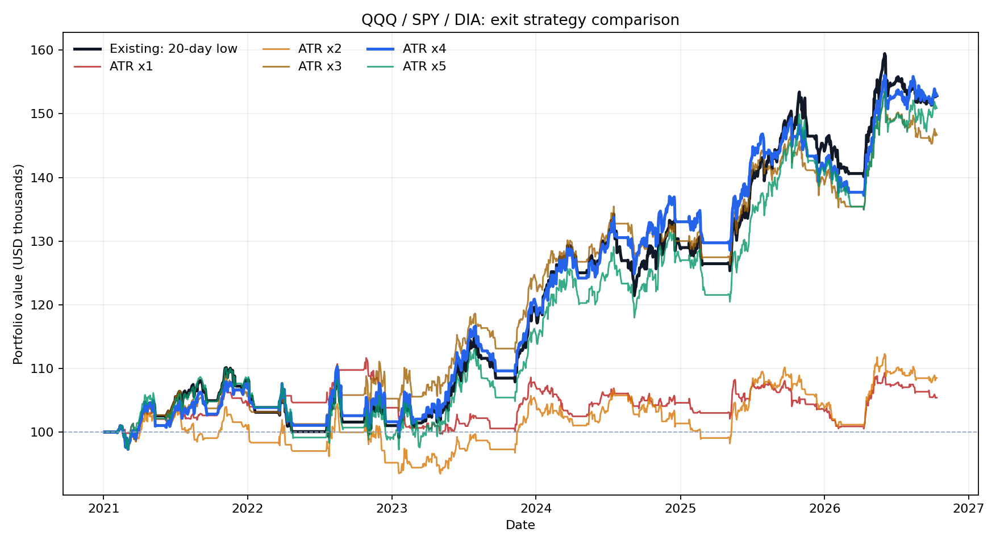

# QQQ·SPY·다우(DIA) 청산 방식 백테스트

2021-01-04 ~ 2026-10-12. 다우는 매매 가능한 DIA ETF로 대체했다. 비트코인과 이더리움은 이 실행에서 제외했다.

## 3개 ETF 묶음

시작 자금 $100,000. 신규 진입 예산은 남은 현금 ÷ (3 − 보유 ETF 수), 정수 주식으로 계산했다.

| 청산 방식 | 총수익률 | 연환산 | 최대 낙폭 | 청산 거래 | 승률 |
|---|---:|---:|---:|---:|---:|
| 기존 20일 저점 | +52.82% | +7.63% | -9.99% | 68 | 51.47% |
| 샹들리에 ATR × 1 | +5.40% | +0.92% | -10.71% | 271 | 40.22% |
| 샹들리에 ATR × 2 | +8.50% | +1.42% | -10.51% | 160 | 41.88% |
| 샹들리에 ATR × 3 | +46.69% | +6.87% | -8.02% | 92 | 50.00% |
| 샹들리에 ATR × 4 | +52.94% | +7.64% | -9.58% | 72 | 51.39% |
| 샹들리에 ATR × 5 | +50.89% | +7.39% | -11.63% | 58 | 51.72% |

## ETF별 단독 운용: 총수익률

| ETF | 기존 | ATR × 1 | ATR × 2 | ATR × 3 | ATR × 4 | ATR × 5 | 단순 보유 |
|---|---:|---:|---:|---:|---:|---:|---:|
| QQQ | +57.07% | +24.76% | +2.44% | +43.86% | +47.89% | +55.00% | +149.39% |
| SPY | +73.51% | -1.18% | +5.31% | +60.99% | +62.27% | +61.55% | +127.79% |
| DIA | +26.53% | -6.86% | +15.84% | +31.95% | +43.42% | +31.44% | +89.19% |

## 조건과 해석

- 진입: 확정 일봉 고가가 직전 20거래일 최고가 돌파. 고정 손절: 진입 신호일 종가 − 2 × 직전 ATR(14), 이후 종가로 판정.
- 기존 청산: 일봉 저가가 직전 20거래일 최저가 아래. 샹들리에 청산: 일봉 저가가 `직전 22거래일 최고가 − 배수 × 직전 ATR(22)` 아래. 보유 중 샹들리에 기준선은 낮추지 않는다. ATR은 TR의 단순 이동평균이다.
- 신호가 난 다음 ETF 거래일의 시가에 체결된 것으로 가정한다. 매수와 매도 각각 가격의 0.1%를 가상 거래 비용으로 차감한다. 마지막 날 보유 중인 포지션은 종가로 평가한다.
- Yahoo Finance 자동 조정 일봉을 사용했다. 실제 토스 지정가 주문의 호가 차이, 미체결, 환전, 세금은 반영되지 않았다.
- 3 ETF 묶음에서 ATR 4배와 기존의 총수익률 차이는 **0.12%포인트**에 불과하다. 이 기간의 배율 우열을 미래 성과로 일반화할 수 없다.
- 단순 보유 수익률은 각 ETF 첫 종가와 마지막 종가를 비교한 참고값이며 전략의 거래 비용 및 현금 비중과 직접 일치하지 않는다.
- 앞선 5자산 묶음과 비교할 때 BTC·ETH를 제거하면 슬롯 수와 투자 배분도 5개에서 3개로 바뀐다. 두 결과의 차이를 가상자산의 순수 기여로 해석할 수 없다.

재실행: `python backtest_cross_asset.py --start 2021-01-01 --end 2026-10-13 --assets QQQ SPY DIA --output backtest_results_etfs`

자세한 수치는 `basket_summary.csv`, `per_asset_summary.csv`, `buy_hold.csv`, `basket_trades.csv` 및 각 평가액 CSV에 있다.
