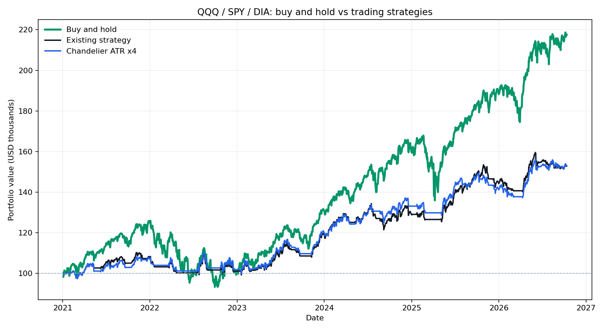

# QQQ·SPY·DIA 단순 보유: 토스증권 매수수수료 반영

기간: 2021-01-04 ~ 2026-10-12. 시작 자금: USD 100,000. 첫 거래일 조정 시가에 한 번 매수한 뒤 추가 매수·매도·리밸런싱 없이 보유하고, 마지막 조정 종가로 평가했다.

## 3개 ETF를 같은 초기 예산으로 보유

각 ETF에 초기 자금의 1/3을 배정하고 정수 주식만 매수했다. 실제 모의 수량은 QQQ 109주, SPY 95주, DIA 119주이며, 남은 현금은 $621.57이다.

| 항목 | 결과 |
|---|---:|
| 최종 평가액 | $217,490.71 |
| 보유 평가 수익률 | +117.49% |
| 연환산 수익률 | +14.42% |
| 최대 낙폭 | -25.91% |
| 매수 수수료 합계 | $99.26 |
| 마지막 날 전량 매도까지 가정한 수익률 | +117.27% |
| 그때 추가될 매도 수수료 / SEC 비용 | $216.85 / $4.47 |

같은 기간의 토스 수수료 반영 3 ETF 매매 전략은 기존 20일 저점 청산 **+52.81%, 최대 낙폭 -9.99%**, 샹들리에 ATR 4배 **+52.93%, 최대 낙폭 -9.58%**였다. 단순 보유는 이 두 전략보다 수익률이 높았지만 낙폭도 컸다. 매매 전략은 신호가 없을 때 현금을 보유하는 반면, 단순 보유는 초기 투자 뒤 계속 노출된다.

## ETF별 단독 보유

각 행은 해당 ETF 하나에 USD 100,000을 배정한 별도 계산이다.

| ETF | 보유 평가 수익률 | 최대 낙폭 | 매수 수수료 | 마지막 날 전량 매도 수익률 |
|---|---:|---:|---:|---:|
| QQQ | +144.20% | -35.05% | $99.65 | +143.95% |
| SPY | +123.45% | -24.47% | $99.76 | +123.22% |
| DIA | +86.17% | -20.72% | $99.66 | +85.98% |

앞선 ETF 보고서의 단순 보유 참고값은 **첫 종가와 마지막 종가**의 가격 비율이었다. 이번에는 실제 매수 시점을 가정해 **첫 시가**에 정수 주식을 사고 토스 매수수수료를 차감했으므로 값이 다르다.

## 비용과 계산 범위

- [토스증권 Open API 공식 안내](https://home.tossinvest.com/ko/open-api)에 따른 기본 미국 주식 수수료 0.1%를 매수에 적용했다. [토스증권 수수료표](https://p.tossinvest.com/en/business?tab=commission)에 따라 $0.01 미만 절사했다. 기간 말까지 매도하지 않았으므로 **보유 평가 수익률에는 매도 수수료와 SEC 비용이 없다**. 별도의 '전량 매도' 열에만 두 비용을 반영했다.
- Yahoo Finance 자동 조정 OHLC를 사용했다. 배당과 분할의 가격 조정 효과를 반영하는 모의 평가이며 실제 ETF 분배금의 현금 지급·재투자를 별도로 재현한 계좌 명세는 아니다. 시작 자금은 이미 USD라고 가정하므로 환전 비용과 환율 변동은 제외했다.
- 과거 거래에 현재 토스 기본 수수료를 가상 적용했다. 당시 계좌별 이벤트·협의 요율과 실제 호가·미체결은 재현하지 않았다. 최대 낙폭은 일별 평가액이 이전 최고점에서 하락한 최대 비율이다.

재실행: `python backtest_buyhold_etfs.py --start 2021-01-01 --end 2026-10-13 --cash 100000 --output backtest_results_etfs_buyhold`

원자료 요약은 `basket_summary.csv`, `per_asset_summary.csv`, 평가액 CSV 및 `assumptions.json`에 있다.
